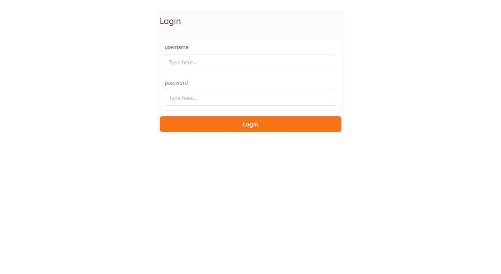
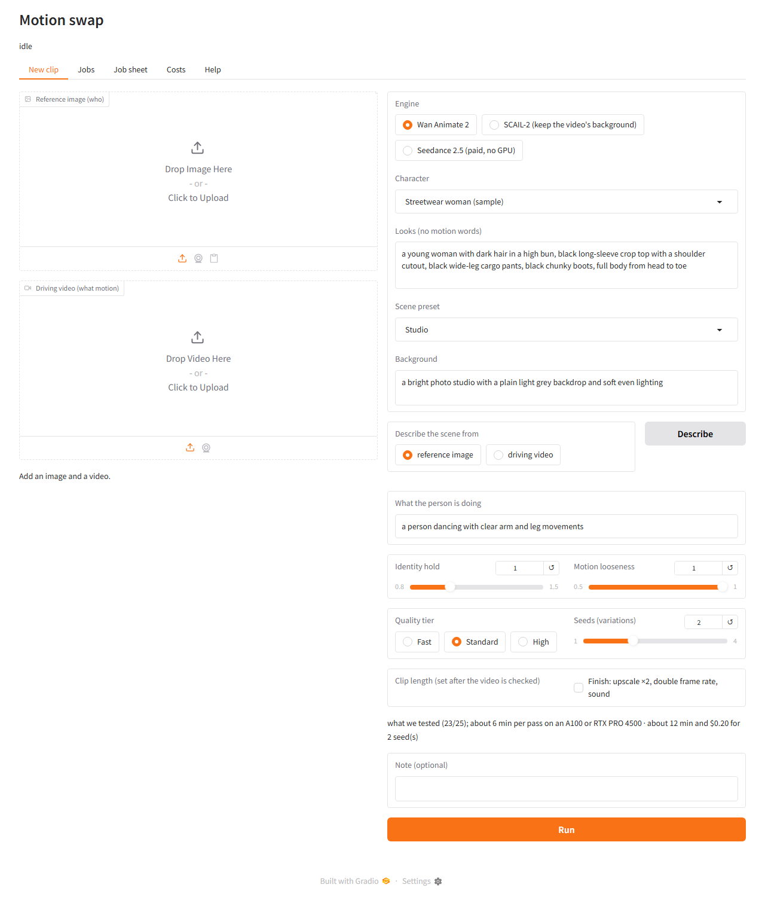
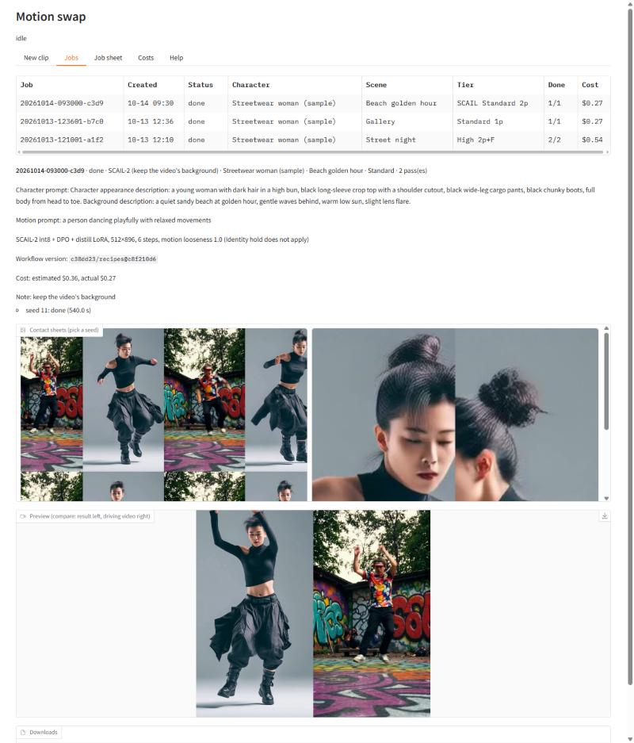
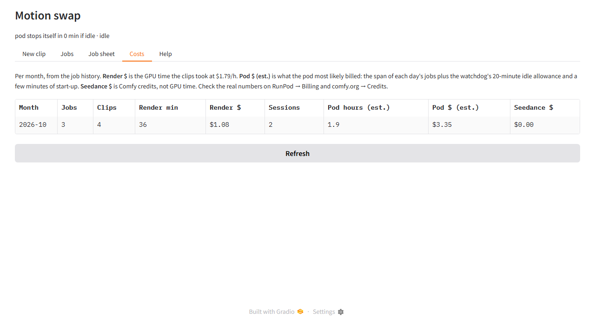

# Team guide: making a motion swap clip

One page for the people who use the app, not the people who maintain it. You need: the app link and password from whoever runs the pod, a **reference image** of the character, and a **driving video** of the move. Read [INPUT_GUIDE.md](INPUT_GUIDE.md) once; good inputs matter more than any setting.

## 1. Is the pod on?

The app only works while the GPU pod is running. Someone with the RunPod account starts it (below); when it is up, the link looks like `https://<random-words>.trycloudflare.com`. Open it and log in as **team** with the shared password.



If the page does not load, the pod is off. Ask the pod owner to start it, or start it yourself if you have the RunPod account:

1. RunPod → **Pods** → **Deploy**.
2. Attach the **creator-data** network volume, pick **L40S** (or A40 when L40S is sold out), template **RunPod PyTorch 2.8**, container disk 20 GB.
3. Deploy, wait for **Running**, open the **web terminal** and paste:
   ```bash
   cd /workspace && (test -d creator-pipeline || git clone https://github.com/Halek-dev/creator-pipeline.git) && cd creator-pipeline && git pull && bash scripts/setup.sh wan-animate-2 && export APP_PASSWORD=<the shared password> && GPU_HOURLY_USD=<pod price> bash scripts/start.sh
   ```
4. In two minutes (fifteen the very first time) it prints a **READY** block with the team link. Share the link in the team chat. The link changes every time the pod starts.

The pod **stops itself** after 20 minutes without a job, so nobody has to remember to turn it off. Starting it again is step 1–4.

## 2. New clip



Left to right, top to bottom:

1. **Reference image**: who. Full body, facing the camera, face clearly visible, plain background. 1024 px or larger on the long side.
2. **Driving video**: what they do. One person, full body, at least 3.5 seconds. Portrait video for the default engine.
3. Press **Check inputs**. Green lines mean go; a warning tells you what will lower quality; a red line blocks the job and says why.
4. **Engine**:
   - **Wan Animate 2** (default): the background and camera come from the scene text. Best for "our character in a studio / on a street at night".
   - **SCAIL-2 (keep the video's background)**: the character is swapped *into* the original video, background and all.
   - **Seedance 2.5 (paid, no GPU)**: ByteDance's model with sound, billed in Comfy credits; use for comparison or when the pod is off.
5. **Character** and **Scene** presets fill in the looks, the background text and the sliders. Edit the text if you want. **Describe from image/video** writes the background text from what is actually in your reference image or video.
6. **Quality tier**: Fast for trying things, Standard for most clips, High for the final one.
7. **Length**: how many 81-frame passes (about 3.4 s each at 24 fps). Only lengths your video can cover are offered.
8. **Seeds**: how many variations to render. Three is a good default; pick the best on the Jobs tab.
9. **Finish**: doubles resolution and frame rate (1440×2560 at 48 fps from the High tier) and adds a touch of film grain. Roughly doubles the time.
10. The estimate line shows minutes and dollars before you press **Run**.

Press **Run**. The job goes into a queue; you can close the page.

## 3. Jobs: pick a seed, download



The table refreshes by itself. Click a row:

- **Contact sheets**: six frames and a face strip per seed. Pick the seed with the cleanest face and hands before watching anything.
- **Preview**: the compare video, result on the left, your driving video on the right.
- **Downloads**: `*_result_*.mp4` is the clip, `*_compare_*.mp4` is the side-by-side, `*_final_*.mp4` is the Finished version when you ticked Finish.

Score with the five-line scorecard (face, hands and feet, edges and background, stability, camera and timing, 1–5 each). Below 20 of 25: try another seed, a sharper reference, or a slower move.

## 4. Many clips at once: Job sheet

Upload your images and videos into the pod's `input` folder via Jupyter (port 8888 on the pod), then a CSV with the columns `image,video,character,scene,seeds,passes,note` and optionally `engine` (`wan`, `scail`, `seedance`). Every row becomes a job.

## 5. Costs



The **Costs** tab shows per month what the clips took in GPU time and what the pod most likely billed, plus Seedance credits. Standard clip about $0.15, High + Finish about $1 at $1.79 per hour.

## 6. Rules

- Only characters the team invented, or real people who gave written consent.
- Label AI-generated content where the platform asks for it.
- Never paste API keys or the app password into chats, files or screenshots.
- Do not share the app link outside the team: whoever has it can spend GPU time and credits.

## When something goes wrong

| You see | Do |
|---|---|
| Page does not load | The pod is off. Start it (section 1). |
| "Can't reach ComfyUI" | The pod is up but the server is restarting. Wait a minute; if it stays, ask the pod owner to run `bash scripts/start.sh`. |
| Job status **error** | Click the row; the reason is in the details (usually a bad input or a missing model profile). |
| Status **partial** | Some seeds rendered, some failed. The finished ones are downloadable. |
| Seedance job errors immediately | The pod was started without `COMFY_API_KEY`, or the Comfy account has no credits. |
| Faces drift | Sharper, closer reference; raise **Identity hold**; High tier. |
| Hands smear in fast moves | Model limit. More seeds, slower choreography, or cut around it. |
