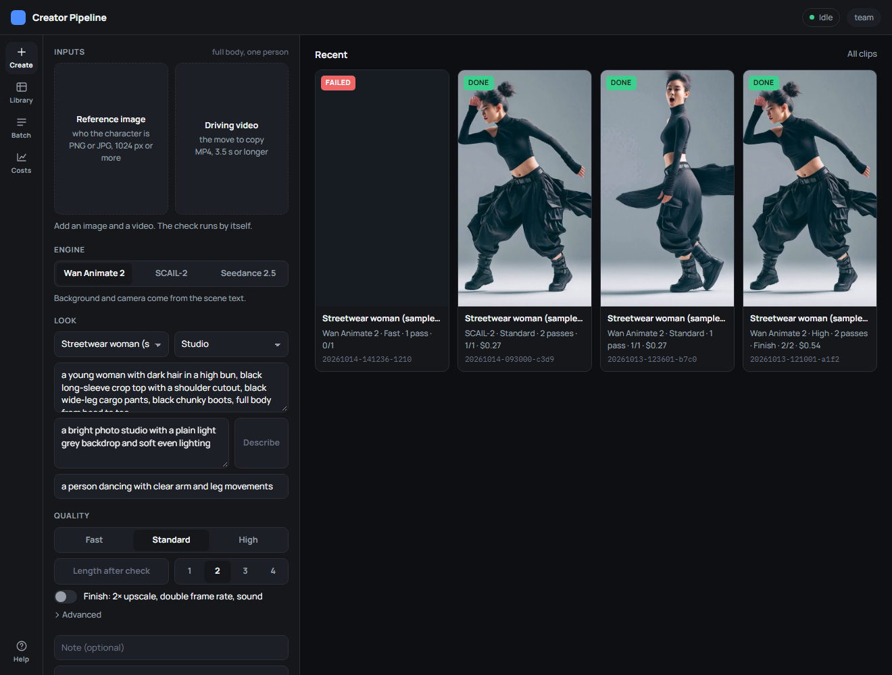
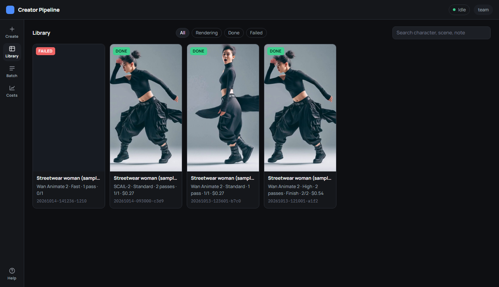
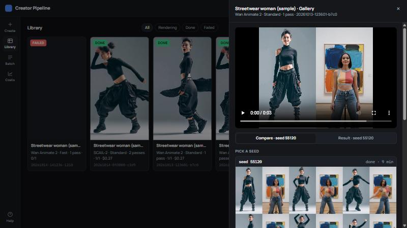

# Team guide: making a motion swap clip

One page for the people who use the app, not the people who maintain it. You need: the app link and password from whoever runs the pod, a **reference image** of the character, and a **driving video** of the move. Read [INPUT_GUIDE.md](INPUT_GUIDE.md) once; good inputs matter more than any setting.

## 1. Is the pod on?

The app only works while the GPU pod is running. Someone with the RunPod account starts it (below); when it is up, the link looks like `https://<random-words>.trycloudflare.com`. Open it; the browser asks for a user name and password. User is **team**, password is the shared one.

If the page does not load, the pod is off. Ask the pod owner to start it, or start it yourself if you have the RunPod account:

1. RunPod → **Pods** → **Deploy**.
2. Attach the **creator-data** network volume, pick **L40S** (or A40 when L40S is sold out), template **RunPod PyTorch 2.8**, container disk 20 GB.
3. Deploy, wait for **Running**, open the **web terminal** and paste:
   ```bash
   cd /workspace && (test -d creator-pipeline || git clone https://github.com/Halek-dev/creator-pipeline.git) && cd creator-pipeline && git pull && bash scripts/setup.sh wan-animate-2 && export APP_PASSWORD=<the shared password> && GPU_HOURLY_USD=<pod price> bash scripts/start.sh
   ```
4. In two minutes (fifteen the very first time) it prints a **READY** block with the team link. Share the link in the team chat. The link changes every time the pod starts.

The pod **stops itself** after 20 minutes without a job, so nobody has to remember to turn it off. Starting it again is step 1–4.

## 2. Create



The left panel is the whole job, top to bottom. The right side is your recent clips.

1. **Inputs**: drop the reference image (who) and the driving video (the move). The check runs by itself: green lines are fine, amber lines tell you what will lower quality, a red line blocks the job and says why.
2. **Engine**: *Wan Animate 2* builds the background from the scene text. *SCAIL-2* swaps the character into your video and keeps its background. *Seedance 2.5* is ByteDance's paid model with sound, billed in Comfy credits, no GPU needed.
3. **Look**: character and scene presets fill the looks and background text and the advanced sliders. Edit the text if you want. **Describe** writes the background text from what is actually in your reference image (or your driving video when SCAIL-2 is selected).
4. **Quality**: tier (Fast to try, Standard for most clips, High for the final one), clip length (only lengths your video can cover are offered), number of seeds (variations to pick from), and Finish (2× upscale, double frame rate, sound).
5. The line above the button shows minutes; the price is on the button. Press **Render**. The clip appears in the feed immediately and shows its progress on the card. You can close the page.

## 3. Library: pick a seed, download



Every clip is a card. Rendering clips show a stage and a progress bar; finished ones show a frame and play on hover. Filter by Rendering, Done or Failed, or search by character, scene or note. Click a card:



- **Compare** player: result on the left, your driving video on the right. Switch to the result or the Finished file with the buttons under the player.
- **Pick a seed**: six frames and a face strip per seed. Choose the seed with the cleanest face and hands before watching anything.
- **Downloads**: `*_result_*.mp4` is the clip, `*_compare_*.mp4` the side-by-side, `*_final_*.mp4` the Finished version.
- **Use these settings** loads the clip's inputs and settings back into Create so you can change one thing and render again.

Score with the five-line scorecard (face, hands and feet, edges and background, stability, camera and timing, 1 to 5 each). Below 20 of 25: try another seed, a sharper reference, or a slower move.

## 4. Many clips at once: Batch

Upload your images and videos into the pod's `input` folder via Jupyter (port 8888 on the pod), then a CSV with the columns `image,video,character,scene,seeds,passes,note` and optionally `engine` (`wan`, `scail`, `seedance`). Every row becomes a job.

## 5. Costs


The **Costs** page shows per month what the clips took in GPU time and what the pod most likely billed, plus Seedance credits. Standard clip about $0.15, High + Finish about $1 at $1.79 per hour.

## 6. Rules

- Only characters the team invented, or real people who gave written consent.
- Label AI-generated content where the platform asks for it.
- Never paste API keys or the app password into chats, files or screenshots.
- Do not share the app link outside the team: whoever has it can spend GPU time and credits.

## When something goes wrong

| You see | Do |
|---|---|
| Page does not load | The pod is off. Start it (section 1). |
| "Can't reach ComfyUI" | The pod is up but the server is restarting. Wait a minute; if it stays, ask the pod owner to run `bash scripts/start.sh`. |
| Job status **error** | Click the row; the reason is in the details (usually a bad input or a missing model profile). |
| Status **partial** | Some seeds rendered, some failed. The finished ones are downloadable. |
| Seedance job errors immediately | The pod was started without `COMFY_API_KEY`, or the Comfy account has no credits. |
| Faces drift | Sharper, closer reference; raise **Identity hold**; High tier. |
| Hands smear in fast moves | Model limit. More seeds, slower choreography, or cut around it. |
